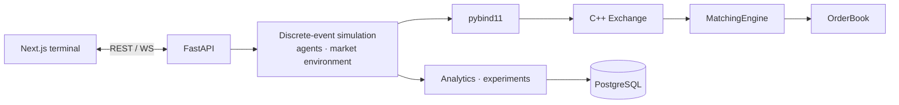

# Udeshi Markets

A high-performance simulated electronic stock exchange: a deterministic C++20 limit-order-book
matching engine, autonomous trading agents competing inside it, and a quantitative research
environment for studying the resulting market behaviour.

> Everything is simulated. No real money, brokerage accounts, or real-world order routing.

**Status:** Phase 1 of 6 is complete: the matching engine and its test suite. The agents,
simulation, API and frontend are under construction; see the
[roadmap](docs/architecture.md#phase-status).

## Matching engine highlights

- **Price–time priority continuous auction.** Limit (GTC / IOC) and market orders, partial fills,
  multi-level sweeps, O(1) cancellation, and self-trade prevention.
- **Exact arithmetic.** Prices are integer ticks; floating point never enters matching.
- **Purpose-built data structures:**
  - best-first `std::map` price ladders (best price is always `begin()`);
  - intrusive doubly linked FIFO queues per level;
  - a slab allocator for orders;
  - an id index for cancels.
- **Deterministic.**
  - A global sequence number on every event.
  - Simulated (not wall-clock) timestamps.
  - Integer-only matching and `-ffp-contract=off`.
  - Identical input gives bit-identical output on every platform.
- **Tested adversarially:**
  - scenario and exact-contract tests;
  - a structural invariant checker;
  - differential testing against an independent naive model over about 250k randomized
    operations (multi-instrument, malformed input, books of 10k+ orders), with full-book
    comparison after every operation;
  - quantity-conservation and limit-price properties;
  - golden cross-platform determinism digests;
  - allocation-failure injection;
  - ASan/UBSan with pool poisoning;
  - mutation testing (49/49 injected bugs caught).

```
Sell 10 @ 101, Sell 5 @ 102, then Buy 12 @ 102
→ trades: 10 @ 101, 2 @ 102      → book: 3 @ 102 remains on the ask side
```

## Architecture



Details: [docs/architecture.md](docs/architecture.md) · [docs/matching-engine.md](docs/matching-engine.md)

## Building and testing the engine

Requirements: CMake ≥ 3.24, Ninja, and a C++20 compiler (Clang 15+ or GCC 12+). GoogleTest is
fetched automatically and pinned by hash.

```bash
cmake --preset release && cmake --build --preset release
ctest --preset release
```

Presets: `debug`, `release`, `asan` (Debug + AddressSanitizer + UndefinedBehaviorSanitizer).

```bash
python3 tools/mutation_test.py --jobs 4   # optional: check the suite catches 49 injected bugs
```

## Repository layout

```
engine/include/udeshi/   public C++ headers (types, order, trade, price level, book, engine, exchange)
engine/src/              implementation
engine/tests/            GoogleTest suite and reference oracle
tools/                   mutation testing
docs/                    design documentation
```

## Technology

C++20 · CMake · GoogleTest. Planned for later phases: Python 3.12 · pybind11 · FastAPI ·
PostgreSQL · Next.js · TypeScript · Tailwind · Playwright · Docker Compose.
