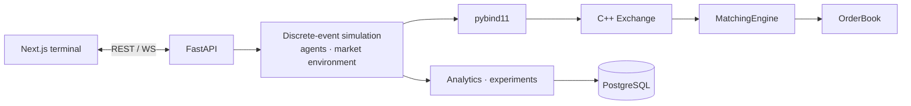

# Udeshi Markets

A high-performance simulated electronic stock exchange: a deterministic C++20 limit-order-book
matching engine, autonomous trading agents competing inside it, and a quantitative research
environment for studying the resulting market behaviour.

> Everything is simulated. No real money, brokerage accounts, or real-world order routing.

**Status:** Phases 1 to 4 of 6 are complete:
- the matching engine;
- the Python bindings, the discrete-event simulation kernel and the exchange API;
- autonomous trading agents in a market environment with hidden fundamentals and news;
- quantitative analytics, and an experiment framework with Monte Carlo runs and PostgreSQL
  persistence.

The frontend and benchmarks come next; see the [roadmap](docs/architecture.md#phase-status).

## Matching engine (C++20)

- **Price–time priority continuous auction.** Limit (GTC / IOC) and market orders, partial fills,
  multi-level sweeps, O(1) cancellation, and self-trade prevention.
- **Exact arithmetic.** Prices are integer ticks; floating point never enters matching.
- **Purpose-built data structures:**
  - best-first `std::map` price ladders (best price is always `begin()`);
  - intrusive doubly linked FIFO queues per level;
  - a slab allocator for orders;
  - an id index for cancels.
- **Deterministic.**
  - A global sequence number on every event.
  - Simulated (not wall-clock) timestamps.
  - Integer-only matching and `-ffp-contract=off`.
  - Identical input gives bit-identical output on every platform.
- **Tested adversarially:**
  - scenario and exact-contract tests;
  - a structural invariant checker;
  - differential testing against an independent naive model over about 250k randomized
    operations (multi-instrument, malformed input, books of 10k+ orders), comparing every
    result and the full book;
  - quantity-conservation and limit-price properties;
  - golden cross-platform determinism digests;
  - allocation-failure injection;
  - ASan/UBSan with pool poisoning;
  - mutation testing: 61/61 injected bugs caught on Linux and macOS, re-checked weekly in CI.

```
Sell 10 @ 101, Sell 5 @ 102, then Buy 12 @ 102
→ trades: 10 @ 101, 2 @ 102      → book: 3 @ 102 remains on the ask side
```

## Simulation kernel and exchange API (Python)

- **pybind11 bindings** expose the engine to Python by value, with native enums and
  hand-written type stubs that a test keeps in sync with the module.
- **Discrete-event kernel.**
  - Simulated nanosecond clock; events ordered by (time, sequence).
  - Participants act only through a context bound to their identity: they can cancel only
    their own orders and see only public data plus reports about their own orders.
  - Configurable order latency; callbacks never run re-entrantly inside an exchange call.
- **Reproducible by construction.**
  - A platform-independent RNG (SplitMix64 with its own logarithm), one stream per participant.
  - A BLAKE2b digest of every event and outcome. Golden digests are checked on Linux and macOS.
- **FastAPI service.**
  - REST endpoints for the simulation lifecycle, market data (book, tape, OHLCV bars) and
    manual order entry.
  - A WebSocket stream with bounded per-client queues.
  - A live runner that paces simulated time by measured wall-clock time × speed.
  - One error format for every failure.

## Trading agents and market dynamics (Python)

- **Five strategies** compete in the exchange:
  - zero-intelligence random traders;
  - inventory-aware market makers that track spread earned and adverse selection;
  - moving-average momentum traders;
  - fundamental traders acting on a noisy private signal;
  - pairs traders using a rolling z-score computed from past observations only.
- **A market environment** with:
  - hidden fundamental values that follow a random walk with calm and volatile regimes;
  - public news and unannounced shocks;
  - liquidity shocks that sweep the book;
  - trading-activity levels;
  - cointegrated pairs.
- **Exact portfolio accounting.** The kernel keeps every participant's cash and positions as
  exact fractions, with average-cost realized P&L. Cash and shares are conserved exactly, and
  the tests check it after every market run.

The details are in [docs/trading-agents.md](docs/trading-agents.md).

## Analytics and experiments

- **Metrics** with documented definitions, causal measurement, and undefined values reported as
  undefined rather than NaN:
  - market: volatility, spreads, depth, imbalance, and pricing error against fundamentals;
  - microstructure: effective and realized spread, price impact, fill rates;
  - agents: P&L, Sharpe ratio, drawdown, exposure, win rate.
- **Experiments:**
  - independent seeded runs, Monte Carlo distributions and parameter sweeps;
  - summaries with Student-t confidence intervals, and Welch comparisons between experiments;
  - CSV export;
  - runs in parallel worker processes, with results identical to a sequential run.

Details: [docs/quantitative-metrics.md](docs/quantitative-metrics.md) and
[docs/market-microstructure.md](docs/market-microstructure.md).

## Quick start

Requirements: Python 3.12, [uv](https://docs.astral.sh/uv/), CMake ≥ 3.24, Ninja, and a C++20
compiler (Clang 15+ or GCC 12+).

```bash
uv sync --all-packages              # builds the C++ extension, installs both packages
uv run python -m udeshi_api         # API on http://127.0.0.1:8000 (docs at /docs)
```

Or run it in a container: `docker compose up --build`.

```bash
B=http://127.0.0.1:8000
ID=$(curl -s -X POST $B/api/simulations -H 'content-type: application/json' -d '{"seed": 7}' \
     | python3 -c 'import json, sys; print(json.load(sys.stdin)["id"])')
curl -s -X POST $B/api/simulations/$ID/start
curl -s -X POST $B/api/markets/ACME/orders -H 'content-type: application/json' \
     -d '{"side": "sell", "price": 100.05, "quantity": 10}'
curl -s -X POST $B/api/markets/ACME/orders -H 'content-type: application/json' \
     -d '{"side": "buy", "type": "market", "quantity": 4}'      # fills 4 @ 100.05
curl -s "$B/api/markets/ACME/orderbook?depth=5"                   # 6 @ 100.05 left on the ask
```

The endpoints, the WebSocket stream and the error format are described in
[docs/api.md](docs/api.md).

## A simulation in Python

```python
from udeshi_markets import Side
from udeshi_markets.simulation import (
    MILLISECOND, MINUTE, OrderIntent, Participant, Simulation, SimulationConfig,
    SimulationContext,
)


class NoiseTrader(Participant):
    """Every ~50 ms, posts a random limit order within 5 ticks of the midprice."""

    def on_start(self, ctx: SimulationContext) -> None:
        self.acme = ctx.instrument_id("ACME")
        ctx.wakeup(ctx.rng.randint(1, 50) * MILLISECOND)

    def on_wakeup(self, ctx: SimulationContext, tag: str) -> None:
        mid = ctx.midprice(self.acme) or 10_000          # ticks; ACME starts at 100.00
        side = Side.BUY if ctx.rng.bernoulli(0.5) else Side.SELL
        price = round(mid) + ctx.rng.randint(-5, 5)
        ctx.submit(OrderIntent(self.acme, side, ctx.rng.randint(1, 10), price=price))
        ctx.wakeup(round(ctx.rng.exponential(1 / 50) * MILLISECOND) + 1)


config = SimulationConfig(duration_ns=MINUTE, seed=7)
summary = Simulation(config, lambda: [NoiseTrader(i) for i in range(1, 11)]).run()
print(summary.trades, summary.volume, summary.digest)   # identical on every run and platform
```

The kernel's design, including its event ordering, lifecycle and determinism guarantees, is
described in [docs/simulation-engine.md](docs/simulation-engine.md).

A whole market of agents, run headless, with P&L summed per strategy:

```python
from udeshi_markets.agents import PopulationConfig, TradingAgent, market_simulation
from udeshi_markets.simulation import MINUTE, EnvironmentConfig, PairConfig, SimulationConfig

simulation = market_simulation(
    SimulationConfig(duration_ns=10 * MINUTE, seed=7),
    PopulationConfig(),  # 10 random, 5 market makers, 5 momentum, 5 fundamental, 1 pairs
    EnvironmentConfig(pairs=(PairConfig("ACME", "NOVA"),)),
)
summary = simulation.run()
marks = simulation.marks()
pnl: dict[str, float] = {}
for pid, agent in simulation.participants.items():
    if isinstance(agent, TradingAgent):
        total = float(simulation.portfolio(pid).total_pnl(marks))
        pnl[agent.strategy] = pnl.get(agent.strategy, 0.0) + total
print(summary.trades, {strategy: round(value) for strategy, value in sorted(pnl.items())})
```

An experiment: do more market makers tighten the spread? Five seeds each, compared with Welch's
t-test:

```python
from udeshi_markets.agents import PopulationConfig
from udeshi_markets.experiments import ExperimentSpec, compare, run_experiment
from udeshi_markets.simulation import MINUTE

few = ExperimentSpec(
    name="few makers", duration_ns=2 * MINUTE, runs=5, population=PopulationConfig(market_makers=2)
)
many = ExperimentSpec(
    name="many makers", duration_ns=2 * MINUTE, runs=5, population=PopulationConfig(market_makers=10)
)
[spread] = compare(run_experiment(few), run_experiment(many), ["spread_bps"])
print(f"spread {spread.mean_a:.2f} -> {spread.mean_b:.2f} bps, Welch p = {spread.p_value:.4f}")
```

## Testing

```bash
cmake --preset release && cmake --build --preset release && ctest --preset release
cmake --preset asan && cmake --build --preset asan && ctest --preset asan   # ASan + UBSan

uv run pytest                                   # bindings, kernel, API (warnings are errors)
uv run mypy                                     # --strict
uv run ruff check python backend && uv run ruff format --check python backend

python3 tools/mutation_test.py --jobs 4         # the suite must catch all 61 injected bugs
```

CI runs all of these on Linux (GCC) and macOS (Clang), and builds and smoke-tests the Docker
image.

## Architecture



Details: [architecture](docs/architecture.md) · [matching engine](docs/matching-engine.md) ·
[simulation kernel](docs/simulation-engine.md) · [trading agents](docs/trading-agents.md) ·
[metrics](docs/quantitative-metrics.md) · [microstructure](docs/market-microstructure.md) ·
[API](docs/api.md) · [development log](docs/development-log.md)

## Repository layout

```
engine/          C++20 matching engine: public headers, implementation, GoogleTest suite
python/          pybind11 bindings and the udeshi_markets package (simulation kernel, market
                 environment, trading agents, analytics, experiments), tests
backend/         FastAPI service (udeshi_api), tests, Dockerfile
tools/           mutation testing
docs/            design documentation
```

## Technology

C++20 · CMake · GoogleTest · Python 3.12 · pybind11 · scikit-build-core · uv · FastAPI ·
Pydantic · pytest · Hypothesis · mypy · Ruff · Docker. Planned for later phases: PostgreSQL ·
Next.js · TypeScript · Tailwind · Playwright.
