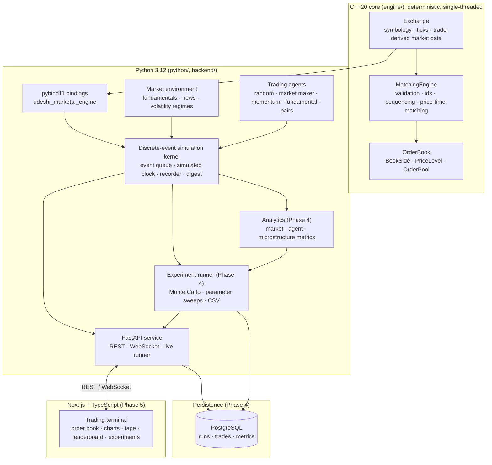
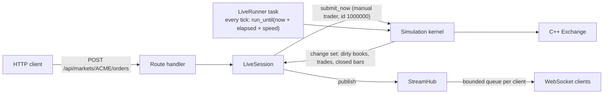

# Architecture

Udeshi Markets is layered so that the parts that must be fast and exactly reproducible (matching)
are isolated from the parts that must be flexible (strategies, research, UI).



The engine, the bindings, the simulation kernel, the market environment, the trading agents and
the API exist today. Components labelled with a later phase are planned.

## Layering rules

1. **The engine is self-contained.** `engine/` depends only on the C++ standard library. It has
   no notion of agents, wall-clock time, randomness, persistence or networking, and it can be
   built, tested and benchmarked on its own.
2. **Exchange logic lives in exactly one place.** Matching, order validation, tick conversion
   and trade-derived market data are implemented once, in C++. Python calls them through the
   bindings and never re-implements them. The frontend only displays what the backend computes.
3. **Simulated time is separate from wall-clock time.** The engine records caller-supplied
   simulated timestamps. The simulation kernel advances its clock by processing events and never
   reads the wall clock or sleeps. Real-time pacing for live viewing is a separate layer in the
   API (the live runner), and headless runs never use it.
4. **Determinism end to end.** The engine is deterministic given its input sequence. The kernel
   adds a seeded, platform-independent random number generator, one derived stream per
   participant, and a total order on events (simulated time, then sequence number). A seed and a
   set of participants therefore fully determine a run, which a BLAKE2b digest of every event and
   outcome makes checkable.
5. **Participants see only what a real one could.** A participant acts through a context bound
   to its own identity. It can cancel only its own orders, and it observes public market data
   (an anonymous tape, aggregated depth) plus reports about its own orders. Fundamental values
   live in the market environment, outside the exchange: participants learn of them only
   through public news and, if granted one, a noisy private signal of the current value. The
   future is generated lazily, so look-ahead bias is ruled out by construction.
6. **One thread owns each exchange.** The engine is single-threaded by design. In the API every
   handler is a coroutine on one asyncio event loop (a test enforces this), so nothing touches an
   exchange concurrently and no locks are needed.

## Runtime view of the API



* A `SessionManager` keeps up to `UDESHI_MAX_SESSIONS` simulations in memory. Each is a
  `LiveSession`: a `Simulation` (the kernel and its own C++ `Exchange`), a `LiveRunner` and a
  `StreamHub`.
* The runner is an asyncio task. Every tick it measures the wall-clock time that actually
  elapsed, processes simulated events up to `now + elapsed × speed` (capped per tick so a busy
  simulation cannot starve the event loop), then publishes what changed.
* Manual orders from the API user go through the same kernel path, digest and ownership checks
  as any agent's. They are processed immediately at the current simulated time and published
  straight away.
* The hub gives every WebSocket client its own bounded queue. A client that falls behind is
  sent a fresh snapshot in place of the updates it missed; it never slows the simulation or
  other clients, and never sees a silent gap.

## Repository layout

```
udeshi-markets/
├── CMakeLists.txt, CMakePresets.json   C++ build (debug / release / asan presets)
├── engine/
│   ├── include/udeshi/                 public headers
│   ├── src/                            implementation
│   └── tests/                          GoogleTest suite, reference oracle, fault injection
├── python/
│   ├── bindings/module.cpp             pybind11 module udeshi_markets._engine
│   ├── udeshi_markets/                 Python package: engine API, type stubs
│   │   ├── simulation/                 kernel, events, participants, recorder, RNG, config,
│   │   │                               market environment, portfolio accounting
│   │   └── agents/                     agent framework, five strategies, population builder
│   └── tests/                          pytest: bindings, stubs, RNG, recorder, kernel
├── backend/
│   ├── udeshi_api/                     FastAPI app: routes, sessions, runner, stream hub
│   ├── tests/                          pytest: REST, WebSocket, runner, hub
│   └── Dockerfile                      multi-stage image, hash-pinned dependencies, non-root
├── pyproject.toml, uv.lock             uv workspace (udeshi-markets + udeshi-api), tool config
├── docker-compose.yml                  the API service
├── tools/mutation_test.py              mutation testing of the engine test suite
├── docs/                               design documentation
└── .github/workflows/
    ├── ci.yml                          engine (Linux + macOS × debug / release / ASan+UBSan),
    │                                   Python (ruff, mypy --strict, pytest), Docker image
    └── mutation.yml                    weekly mutation run on Linux and macOS
```

Later phases add analytics and experiments (under `python/udeshi_markets/`), `frontend/`
(Next.js) and `bench/` (benchmarks).

## Phase status

| Phase | Scope | Status |
| --- | --- | --- |
| 1 | C++ matching engine, price-time priority, cancellation, tests | Done |
| 2 | pybind11 bindings, exchange API, discrete-event loop | Done |
| 3 | Trading agents, market dynamics, portfolio accounting | Done |
| 4 | Analytics, experiments, Monte Carlo, PostgreSQL | Planned |
| 5 | Frontend, WebSockets, visualisations | Planned |
| 6 | Benchmarks, profiling, optimisation, docs | Planned |

## Further reading

* [matching-engine.md](matching-engine.md): the engine's data structures, matching rules and
  verification.
* [simulation-engine.md](simulation-engine.md): the discrete-event kernel, participants,
  determinism and the run digest.
* [trading-agents.md](trading-agents.md): the strategies, the market environment and portfolio
  accounting, with their mathematics.
* [api.md](api.md): REST endpoints, the WebSocket stream and the error format.
* [development-log.md](development-log.md): what was built in each phase, and why.
