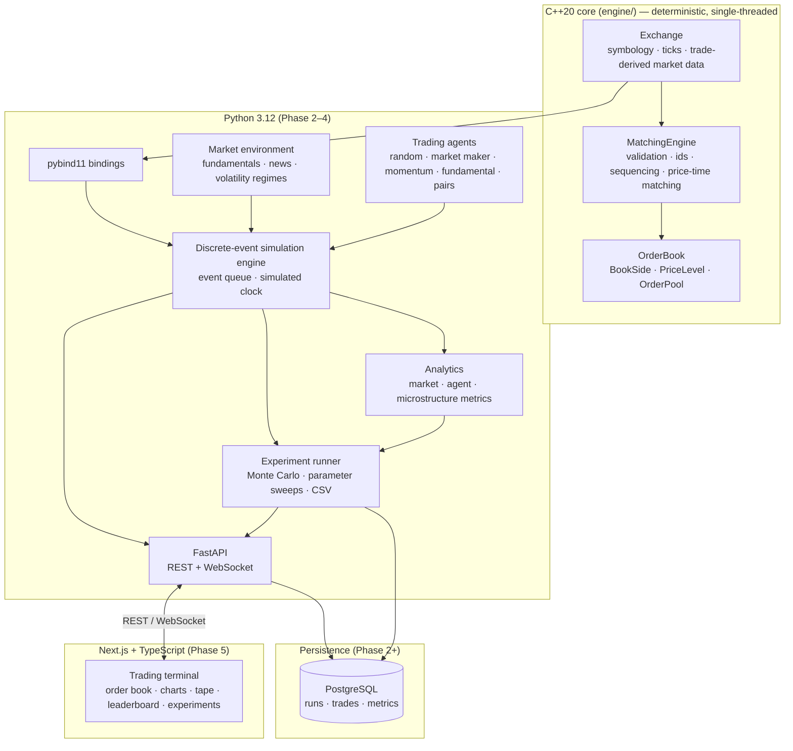

# Architecture

Udeshi Markets is layered so that the parts that must be fast and exactly reproducible (matching)
are isolated from the parts that must be flexible (strategies, research, UI).



## Layering rules

1. **The engine is self-contained.** `engine/` depends only on the C++ standard library. It has
   no notion of agents, wall-clock time, randomness, persistence or networking, and it can be
   built, tested and benchmarked on its own.
2. **Exchange logic lives in exactly one place.** Matching, order validation and trade-derived
   market data are implemented once, in C++. Python wraps them and never re-implements them. The
   frontend only displays what the backend computes.
3. **Simulated time is separate from wall-clock time.** The engine records caller-supplied
   simulated timestamps. The Phase 2 discrete-event loop advances the simulated clock by
   processing events, never by sleeping. Real-time pacing for the live UI is a presentation
   concern layered on top.
4. **Determinism end to end.** The engine is deterministic given its input sequence. Phases 2–4
   extend this with seeded, platform-independent random number generation and a total order on
   simulation events (simulated time, then sequence number), so a seed fully determines a run.
5. **The exchange cannot see hidden information.** Fundamental values and news live in the
   market environment. Agents observe only what a real participant could see (public market data
   and their own fills), plus whatever signal a strategy is explicitly given. This prevents
   look-ahead bias by construction.

## Repository layout

```
udeshi-markets/
├── CMakeLists.txt, CMakePresets.json   build (debug / release / asan presets)
├── engine/
│   ├── include/udeshi/                 public headers
│   ├── src/                            implementation
│   └── tests/                          GoogleTest suite + reference oracle
├── tools/mutation_test.py              mutation testing of the engine test suite
├── docs/                               design documentation
└── .github/workflows/ci.yml            Linux + macOS, debug / release / ASan+UBSan
```

Later phases add `python/` (bindings, simulation, agents, analytics), `backend/` (FastAPI),
`frontend/` (Next.js), `bench/` (benchmarks) and `docker-compose.yml`.

## Phase status

| Phase | Scope | Status |
| --- | --- | --- |
| 1 | C++ matching engine, price-time priority, cancellation, tests | Done |
| 2 | pybind11 bindings, exchange API, discrete-event loop | Planned |
| 3 | Trading agents, market dynamics, portfolio accounting | Planned |
| 4 | Analytics, experiments, Monte Carlo | Planned |
| 5 | Frontend, WebSockets, visualisations | Planned |
| 6 | Benchmarks, profiling, optimisation, docs | Planned |

See [matching-engine.md](matching-engine.md) for the engine design in detail.
