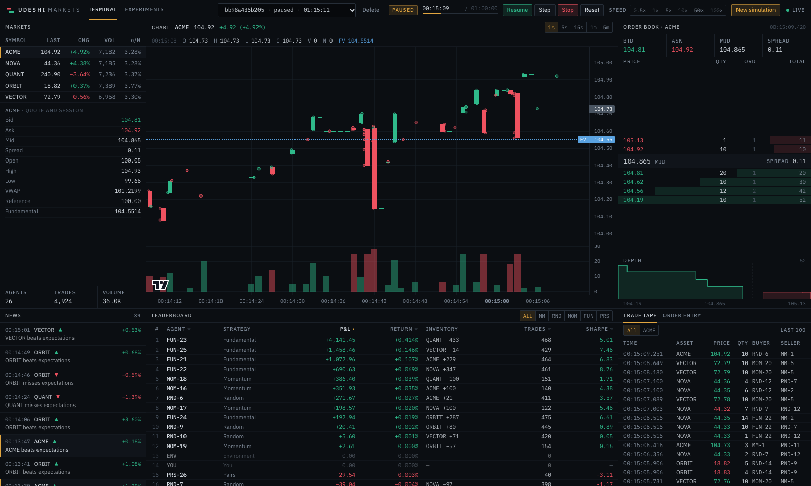
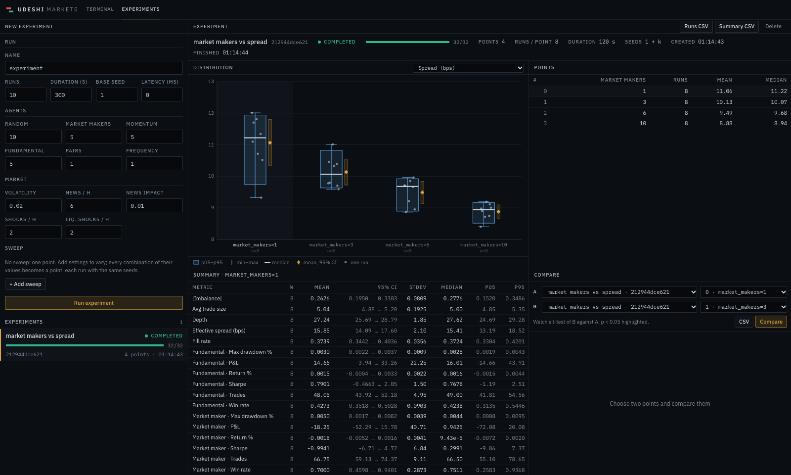
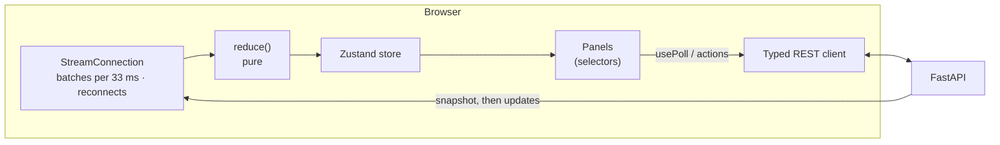

# Frontend

The trading terminal and the experiment dashboard live in [`frontend/`](../frontend), a Next.js
16 application (React 19, TypeScript in strict mode, Tailwind CSS 4). It is a client of the API
in [api.md](api.md) and nothing more: every number on screen was computed by the backend.

```bash
uv run python -m udeshi_api                     # the API, on :8000
cd frontend && npm ci && npm run dev            # the terminal, on http://localhost:3000
```

`UDESHI_API_URL` tells the terminal where the API is (default `http://127.0.0.1:8000`). It is
read by the server at request time and handed to the browser, which connects to the API
directly, so one build works against any backend; it must be an address the *browser* can
reach. The API must allow the terminal's origin (`UDESHI_CORS_ORIGINS`, which by default
allows `http://localhost:3000` and `http://127.0.0.1:3000`).

## Pages

| Route | Contents |
| --- | --- |
| `/` | The terminal: market overview and news · price chart and leaderboard · order book with depth, and the trade tape or order entry. The top bar holds the simulation picker, the state, the simulated clock, the lifecycle buttons, the speed and the configuration dialog. |
| `/experiments` | The experiment dashboard: create experiments (with sweeps), follow their progress, inspect each metric's distribution per sweep point, and compare two points with Welch's t-test. |

From the `lg` breakpoint (1024 px) up, the terminal tiles the viewport in three columns, and
each panel scrolls on its own. Below it, the panels stack and the page scrolls.



## Panels

| Panel | Files | What it shows |
| --- | --- | --- |
| Top bar | `components/controls/` | Simulation picker, state, simulated clock and progress, start / pause / resume / step / stop / reset, speed, and the configuration dialog (run settings, agent counts, market environment, the ACME/NOVA pair). With no simulation on the server, an overlay offers a quick start. |
| Markets | `components/overview/` | Last price, change from the reference price, volume and volatility per hour for every symbol (selecting one points the other panels at it), the selected market's quote and session, and the totals of agents, trades and volume. |
| Chart | `components/chart/` | Candles at 1 s to 5 m (only intervals the backend can aggregate to), a volume pane, every recent trade as a dot at its exact time and price, news markers, and the hidden fundamental value as a dashed line. All times are simulated. |
| Order book | `components/book/` | Best bid, ask, mid and spread; the ladder (price, quantity, orders, cumulative quantity) with depth bars; a depth chart. |
| Trade tape | `components/tape/` | The latest executions across all markets (or the selected one): time, asset, price, quantity, buyer and seller, coloured by aggressor. |
| Order entry | `components/ticket/` | Limit and market orders as the API user (participant 1,000,000): the exchange's answer with every fill, and the user's resting orders with cancel buttons. |
| News | `components/news/` | Published news, newest first, with sentiment and log impact. |
| Leaderboard | `components/leaderboard/` | Every participant's P&L, return, inventory, trades and Sharpe ratio, sortable and filterable by strategy; a row opens the participant's detail (positions, open and recent orders, activity, strategy measures). |
| Experiments | `components/experiments/` | The form (with a sweep editor), the list with progress, the selected experiment's distribution chart (per sweep point: p05–p95 box, min–max whiskers, median, mean with its 95% interval, and every run as a dot), its points and summary tables, and a Welch comparison of any two points, with CSV downloads. |



## Data flow



* **Types are generated, not written.** `src/lib/api-types.ts` is generated from the API's
  OpenAPI schema (`npm run generate:api`, after `uv run python -m udeshi_api.openapi >
  openapi.json`). CI regenerates both files and fails if they differ from the committed ones,
  so a backend change the frontend does not follow breaks the type check. The stream's
  messages are not in the schema, but their payloads are the REST models, so
  `src/lib/stream/messages.ts` builds their types from the generated ones.
* **One stream per simulation.** `StreamConnection` (`src/lib/stream/connection.ts`) opens the
  simulation's WebSocket for all symbols:
  * It buffers incoming messages and delivers them in batches, at most one every 33 ms. A
    burst from one runner tick becomes one state change and one render.
  * It retries a dropped connection with exponential backoff (250 ms, doubling, at most 5 s).
    Every connection starts with a snapshot that replaces the client's state, so a reconnect
    loses nothing.
  * It gives up only when the server says the simulation or a symbol does not exist (close
    codes 4404 and 4400) or that the simulation was deleted (a `closed` message).
  * Frames that are not known messages are reported to the console and ignored.
* **A pure reducer.** `reduce(state, message)` (`src/lib/stream/reducer.ts`):
  * A `snapshot` replaces everything: after connecting, after a reset, or when the server
    resynchronised a client that fell behind.
  * `book`, `market` and `agents` replace what they carry.
  * `trades`, `bars` and `news` are appended, keeping the most recent 200 trades per symbol,
    2,000 bars and 200 news items.
  * Updates for a symbol the snapshot did not include are ignored.
  * Unchanged markets keep their object identity, so their panels do not re-render.
* **REST for everything else.** Panels fetch what the stream does not carry with `usePoll`
  (`src/lib/hooks.ts`). Examples:
  * candles at a chosen interval;
  * live analytics;
  * an agent's detail;
  * the API user's open orders;
  * experiments.

  Its semantics:
  * A new **key** is a different thing (another simulation, agent or experiment): it fetches
    at once and drops the old result.
  * A new **version** is the same thing, changed: it fetches at once but keeps showing the old
    result until the new one arrives, so nothing blinks.
  * An answer that arrives after either changed is discarded.
  * A failure is logged and retried (at the polling interval, or after 5 s), and the panel
    says what failed.
  * Polling is fixed, adaptive (an experiment list polls every second while something runs,
    then every 5 s), or off.
* **While paused, panels follow events, not a timer.** `useMoment()` is `"live"` while the
  simulation runs, and panels then poll. Otherwise it is a value that changes whenever what
  the REST endpoints report can have changed: a snapshot, a step that moved the clock, or a
  trade that did not (a manual order while paused). Panels use it as their poll's version.

## Display only

The brief's rule is that the frontend does no financial calculation. Where a panel needs a
derived number, the backend provides it:

| Shown | Source |
| --- | --- |
| Prices, changes, volume, VWAP, best bid / ask, mid, spread | `market` and `book` messages (`MarketOut`, `OrderBookOut`) |
| Depth bars and the depth chart | `cumulative_quantity` on every book level, added to the API for this |
| Candles at 5 s, 1 m, … | `GET /api/markets/{symbol}/history?interval_seconds=` aggregates on the server |
| Volatility per hour | `GET /api/simulations/{id}/analytics` |
| Buyer and seller on the tape | `buyer` / `seller` on every trade, the API's observer tape |
| A news item's effect | `change_percent` on every news item ((e^impact − 1) × 100, next to the log `impact`) |
| P&L, return, inventory, Sharpe | the `agents` message (`AgentOut`) |
| Experiment means, intervals, quantiles, t-tests | `GET /api/experiments/{id}` and `/compare` |

What the frontend does do: format numbers, sort and filter rows, count rows (active agents),
and map values to pixels (bar widths, chart coordinates, the jitter of dots in a distribution
plot).

## Testing

| Layer | Tool | What |
| --- | --- | --- |
| Units | Vitest (`npm test`) | The stream reducer (snapshot replacement, per-symbol updates, caps, unknown symbols), the connection (batching, backoff, final close codes, deleted simulations, `stop()`), formatting. |
| End to end | Playwright (`npx playwright test`) | The real backend and a production build. Tests create a market through the API, start it, pause it and step it by a fixed number of events, so what the page shows is deterministic. They then check the values on screen against the REST API, and drive the controls, the order ticket and the experiment dashboard. `regressions.spec.ts` keeps every bug the review reproduced, with failures injected at the network layer (`page.route`) where needed. `screenshots.spec.ts` regenerates the images in this document (`SCREENSHOTS=1`). |
| Static | ESLint (Next's core-web-vitals and TypeScript rules, no warnings), `tsc --strict` with `noUncheckedIndexedAccess`, Prettier | |

Playwright's configuration (`frontend/playwright.config.ts`) starts the API with `uv run` from
the repository root (or `E2E_API_COMMAND`), and the terminal with `next build && next start`
(or `E2E_WEB_COMMAND`), on ports `E2E_API_PORT` (8011) and `E2E_WEB_PORT` (3100). Tests run one
at a time: they share one backend, and the terminal opens the most recent simulation.

## Design

* **Palette.** One dark palette, defined as Tailwind theme tokens in `src/app/globals.css`:
  * near-black panels separated by 1 px rules;
  * green for bids and buying;
  * red for asks and selling;
  * amber for focus and selection;
  * blue for information.
* **Type.** IBM Plex Sans for text, IBM Plex Mono with tabular figures for every number.
  Numbers are right-aligned and use the instrument's tick decimals. Labels are small caps.
* **Density.** Dense tables with rows about 18 px high, thin headers, and no cards, shadows or
  gradients.
* **Fonts are self-hosted** from npm packages, so builds need no network access beyond the
  package registry.

## Limitations

* **Polling where the stream has nothing.** Analytics, the market totals, open orders, agent
  details and experiments are polled over REST (every 1–5 s while something changes), not
  pushed.
* **Live analytics get dearer as a run grows.** The backend recomputes them over the whole
  run on every request: about 35 ms at 30 simulated minutes, 200 ms at 2 hours. Polling every
  5 s keeps that small at the default length. Incremental analytics are Phase 6 work.
* **The chart shows recent trades only.** It draws trade dots for the 200 most recent trades
  per symbol that the store keeps, and the tape lists the latest 100.
* **Autoscaling follows the candles.** The fundamental-value line can lie outside the visible
  price range; the legend always shows its value.
* **No authentication.** The terminal trades as the one API user (participant 1,000,000).
  The brief has no notion of user accounts.

