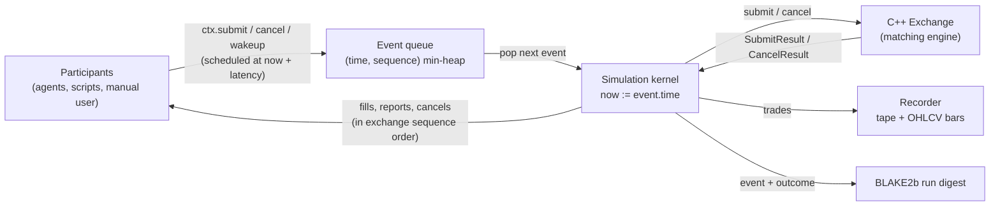
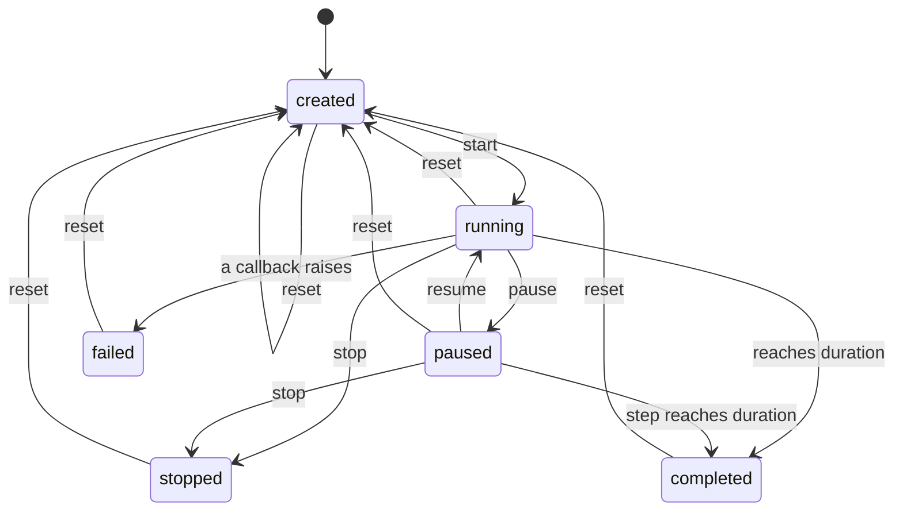

# Simulation Engine

The simulation layer ([`python/udeshi_markets/simulation`](../python/udeshi_markets/simulation))
drives the C++ exchange with a **discrete-event simulation**.
* Time is simulated: an integer number of nanoseconds since the start of the run.
* Time advances only by processing events. Nothing in the kernel reads the wall clock or
  sleeps.
* A run is therefore a pure function of three things: its configuration, its participants, and
  any external inputs.



## Time and event ordering

* Events live in a min-heap ordered by **(simulated time, insertion sequence)**. The sequence is
  a counter assigned when an event is scheduled, so events at the same instant run FIFO, in the
  order they were scheduled. That order is itself deterministic.
* Processing an event sets `now` to its timestamp. `now` never decreases.
* Participants never act re-entrantly. `ctx.submit(...)` and `ctx.cancel(...)` *schedule* an
  arrival at `now + order_latency_ns`, even with zero latency. A participant reacting to a fill
  therefore never runs inside the exchange call that produced the fill.
* **A run of duration D covers simulated time [0, D).** An event scheduled at or after D is
  never processed. A run stopped at time t covers [0, t]: everything that happened at the
  instant t is kept, so the final bar ends at t + 1 ns.
* Bad input fails in the participant's own call, before any state changes: an `OrderIntent`
  whose values do not fit the engine's integer types, a wakeup with a non-integer delay or a
  tag that is not an encodable string, or an id that is out of range. Values that fit but break
  the exchange's rules (a zero quantity, an off-grid price) are rejected by the exchange, with a
  reason, like any other order.

| Event | Effect |
| --- | --- |
| `OrderArrival` | The order reaches the exchange: owner = participant, timestamp = `now`. |
| `CancelArrival` | Ownership-checked cancel (see below). |
| `Wakeup` | A timer the participant scheduled for itself (`ctx.wakeup(delay, tag)`). |

### Clock semantics of the controls

| Method | Behaviour |
| --- | --- |
| `step(n)` | Processes up to `n` events. If none is left before the end time, the run completes. |
| `run_until(t)` | Processes every event at or before `t` (and before the end time), then moves the clock to `min(t, end)` even if nothing happened. With `max_events` (at least 1), it stops early and leaves the clock at the last processed event. |
| `run()` | Headless: starts if needed and runs to the end. Returns a `SimulationSummary`. |

### Lifecycle



An invalid transition raises `SimulationStateError`; the API maps it to HTTP 409. `reset`
rebuilds everything from the configuration: a new exchange, queue and recorder, and *fresh*
participants from the participant factory. A reset run therefore reproduces the original exactly.

**Failure.** If a participant callback (or the engine) raises while the simulation is changing,
some participants may already have been told about an event and others not. The simulation
then moves to `failed`, a terminal state: the exception propagates, is kept in
`simulation.failure`, the recording is closed, and every further step is refused until a reset.

## Participants

A `Participant` subclass overrides the callbacks it needs:

| Callback | When it is called |
| --- | --- |
| `on_start` | Once, at start. |
| `on_wakeup` | When a timer the participant scheduled fires. |
| `on_order_report` | The outcome of one of its own submissions. |
| `on_fill` | Every execution involving one of its orders. |
| `on_cancel` | Its cancel was processed, or self-trade prevention removed its order. |
| `on_stop` | Once, when the run stops or completes. |

**Information boundary.** A participant acts only through the `SimulationContext` it is given.
The context binds its identity, so a participant can only trade as itself. It sees public market
data: the book, the statistics and the anonymised trade tape. It also sees reports about its own
orders. A `Fill` carries no counterparty identity, and a participant's own orders are visible to
it but no one else's. Strategies (Phase 3) therefore cannot use information a real market
participant wouldn't have.

**Ownership-checked cancels.** At arrival the kernel looks up the order:
* a missing order gives `NOT_FOUND`;
* someone else's order also gives `NOT_FOUND`, and the exchange is never touched, so cancels
  cannot be used to discover other participants' orders (the digest still records which case
  it was);
* otherwise the order is cancelled.

Order ids are assigned by the exchange from one global counter, as on many real venues, so the
gap between two of a participant's own order ids reveals how many orders were accepted in
between. The public tape does not carry the exchange's global sequence number, which would also
reveal rejected and cancelled orders.

**Notification order.**
1. The executions and self-trade-prevention cancels caused by one submission are delivered in
   exchange sequence order, with the aggressor's fill before the resting order's fill for the
   same trade.
2. The submitter then receives its `OrderReport`.

**External actions.** `submit_now` and `cancel_now` process an order or cancel immediately at
the current time. The API uses them for the manual user.

**No re-entrancy.** Every control method (`start`, `pause`, `resume`, `stop`, `reset`, `step`,
`run_until`, `submit_now`, `cancel_now`) refuses to run from inside any participant callback,
`on_start` and `on_stop` included.

**Scripted participants.** `ScriptedParticipant` replays a fixed list of timed orders and
cancels, which is useful for scenarios, tests and replays. A scripted cancel names an earlier
scripted order by its position in the script, because exchange order ids are only known at
runtime. A cancel whose time comes before its order has been reported is held until the report
arrives; a cancel of a rejected order is not sent.

## Recording

`MarketRecorder` keeps, per instrument:
* the **public tape** (`PublicTrade`): time, price, quantity and aggressor side, with no order
  ids or traders. It can optionally be bounded with `trade_history_limit`;
* **OHLCV bars** of width `bar_interval_ns`.

Bars are half-open intervals `[k·w, (k+1)·w)`, and a trade belongs to the bar its *timestamp*
falls in. Bars are therefore a pure function of the trade stream, independent of the order in
which same-instant events are processed. An interval with no trades carries the previous close
forward with zero volume; before the first trade, that close is the reference price. The final
partial bar is closed when the run ends, and nothing can be recorded afterwards. Bar volume
always equals traded volume. Bars are built eagerly, so a simulation may record at most
`MAX_BARS` (10 million) bars in total.

For live publishing (`track_changes=True`), `drain_changes()` returns:
* the books that changed;
* the new public trades;
* every newly closed bar, including bars closed as a side effect of a trade landing in a later
  bar.

## Determinism

* **Run digest.** Every processed event and its complete outcome are folded into a BLAKE2b
  digest:
  * ids, sequence numbers, status and reasons, and quantities;
  * every trade and every self-trade-prevention cancel.

  * how and when the run ended.

  Records have fixed sizes, and wakeup tags are length-prefixed, so different runs cannot
  produce the same byte stream. Two runs are identical exactly when their digests match. Manual
  API orders are hashed like any other event. A golden digest for a fixed multi-participant scenario is pinned in the
  tests and checked on Linux and macOS in CI.
* **Random numbers** ([`rng.py`](../python/udeshi_markets/simulation/rng.py)).
  * Library-defined distributions such as `random.gauss` or NumPy `Generator` methods may
    change algorithm between versions. The platform maths library (`math.log`) can also differ
    in the last bits between operating systems. Either breaks reproducibility.
  * `DeterministicRng` therefore uses SplitMix64 for raw 64-bit words and builds every
    distribution from exactly rounded IEEE operations: `+ − × ÷` and `sqrt`.
    * The logarithm is its own: `x = m·2ᵉ` with `m ∈ [√½, √2)`, and `ln m = 2·atanh(s)` summed
      in Horner form, smallest term first, with ln 2 split in two parts. It is within 2 ulps of
      a 60-digit reference (a test checks 4,000 inputs, including the hardest ones).
    * Normals use the Marsaglia polar method, which needs only `log` and `sqrt`.
    * Exponentials use inversion.
  * Each participant gets its own stream, `DeterministicRng.derive(seed, "participant", id)`,
    so adding a participant doesn't perturb the others' randomness. Labels are encoded with
    their type, so the int `3` and the string `"3"` name different streams.
  * Golden values pin the streams across platforms and Python versions.
* **No hidden nondeterminism.** Participants are started and notified in id order. No iteration
  over an unordered container decides event order. The C++ engine is deterministic by design
  (see [matching-engine.md](matching-engine.md)).

## Example: a headless run

```python
from udeshi_markets import Side
from udeshi_markets.simulation import (
    SECOND, OrderIntent, ScriptedOrder, ScriptedParticipant, Simulation, SimulationConfig,
)

def participants():
    return [
        ScriptedParticipant(1, [ScriptedOrder(1 * SECOND, OrderIntent(0, Side.SELL, 10, price=10_100))]),
        ScriptedParticipant(2, [ScriptedOrder(2 * SECOND, OrderIntent(0, Side.BUY, 4, price=10_100))]),
    ]

simulation = Simulation(SimulationConfig(duration_ns=10 * SECOND), participants)
summary = simulation.run()
print(summary.trades, summary.volume, summary.digest)      # 1 4 <digest>
print(simulation.recorder.bars(0)[2])                       # the bar containing the trade
```

## Live runs

The API's `LiveRunner` sits on top of the kernel. It is a presentation layer, not part of the
simulation.
* Every tick (50 ms by default) it measures the wall-clock time that actually elapsed and
  advances the simulation by `elapsed × speed`.
* It then publishes what changed to WebSocket subscribers.
* A per-tick event cap stops a heavy simulation from starving the event loop. Such a simulation
  simply falls behind real time, and correctness is unaffected because event order never depends
  on pacing.
* Headless runs and experiments never use the runner.

## Limitations (Phase 2)

* The kernel is single-threaded and runs in Python. The hot path, matching, is C++. Phase 6
  will profile whether event dispatch or agent code needs to move to C++ for large Monte Carlo
  sweeps.
* Latency is a single configured constant for every participant. Per-participant or random
  latency would be a straightforward extension of the scheduling call.
* Market data events (news, fundamental changes) and agents arrive in Phase 3.
